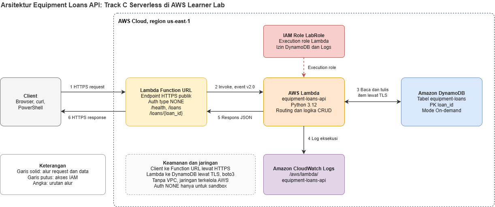

# AWS Equipment Loans API

Proyek individu AWS Cloud Computing Week 12 , Track C Serverless, kasus peminjaman alat laboratorium.

- **Nama:** Juan Christopher Reinaldo Sipayung (24/544528/TK/60526)
- **Region:** `us-east-1` (AWS Learner Lab)
- **Laporan lengkap** (architecture diagram, design brief, deployment plan, AWS evidence): [`docs/Laporan_Week12.pdf`](docs/Laporan_Week12.pdf)

## Arsitektur



Client → Lambda Function URL (HTTPS) → AWS Lambda `equipment-loans-api` → Amazon DynamoDB `equipment-loans`. Log ke CloudWatch Logs. Akses lewat IAM `LabRole`.

## Komponen Utama
1. **Lambda Function URL** sebagai endpoint HTTPS publik (payload format v2.0). Dipakai sebagai pengganti API Gateway karena role sandbox `voclabs` membatasi `apigateway:POST` / `apigateway:PUT`.
2. **AWS Lambda** (Python 3.12) bernama `equipment-loans-api`: logika CRUD entitas `EquipmentLoan`, dan membuat tabel DynamoDB otomatis bila belum ada.
3. **Amazon DynamoDB** tabel `equipment-loans`, partition key `loan_id` (String), mode On-demand.
4. **IAM `LabRole`** sebagai execution role Lambda untuk akses DynamoDB dan CloudWatch Logs.

## Data Entity: `EquipmentLoan`
| Atribut | Tipe | Keterangan |
|---|---|---|
| `loan_id` | String | Partition key, UUID v4 otomatis saat POST |
| `borrower_name` | String | Nama peminjam |
| `borrower_id` | String | NIM / ID peminjam |
| `equipment_name` | String | Nama alat |
| `quantity` | Number | Jumlah unit, minimal 1 |
| `status` | String | `BORROWED` saat dibuat, `RETURNED` saat dikembalikan |
| `borrowed_at` | String | ISO 8601 UTC |
| `due_date` | String | `YYYY-MM-DD` |
| `returned_at` | String | Terisi otomatis saat status `RETURNED` |

## Endpoint API
| Method | Path | Operasi | Keterangan |
|---|---|---|---|
| `GET` | `/health` | Health Check | Cek status Lambda dan koneksi DynamoDB |
| `POST` | `/loans` | Create | Catat peminjaman baru (201) |
| `GET` | `/loans` | Read (list) | Ambil semua data peminjaman |
| `GET` | `/loans/{loan_id}` | Read (detail) | Ambil satu data |
| `PUT` | `/loans/{loan_id}` | Update | Ubah `status`, `due_date`, atau `quantity` |
| `DELETE` | `/loans/{loan_id}` | Delete | Hapus data peminjaman |

Contoh:
```bash
curl -X POST "$URL/loans" -H "Content-Type: application/json" \
  -d '{"borrower_name":"Budi","borrower_id":"220123456","equipment_name":"Oscilloscope","quantity":1,"due_date":"2026-12-03"}'
curl -X PUT "$URL/loans/<loan_id>" -H "Content-Type: application/json" -d '{"status":"RETURNED"}'
```

## Struktur Repository
```text
.
├── docs/
│   ├── Laporan_Week12.docx                     # laporan versi editable (Word / Google Docs)
│   ├── Laporan_Week12.pdf                      # laporan lengkap siap kumpul (PDF)
│   └── arsitektur-equipment-loans.drawio.png   # architecture diagram
├── evidence/
│   ├── screenshots/                            # screenshot konsol AWS (01-09)
│   ├── aws-evidence-*.txt                      # output uji live
│   └── dynamodb-backup-*.json                  # backup isi tabel
├── scripts/
│   ├── README.md
│   ├── setup-aws.ps1                           # deploy (PowerShell)
│   ├── setup-aws.sh                            # deploy (Bash / CloudShell)
│   └── save-evidence.ps1                       # uji CRUD live + backup
├── src/
│   ├── lambda_function.py                      # handler Lambda
│   └── local_test.py                           # unit test offline
├── requirements.txt
├── .gitignore
└── README.md
```

## Uji Lokal
```bash
python -m unittest discover -s src -p "*test*.py" -v
```

## Deployment Plan (AWS Learner Lab)
Sesi Learner Lab reset sekitar 3 jam dan Function URL berubah bila Lambda dibuat ulang, jadi infrastruktur dibangun ulang dengan script:
1. Start Lab, salin kredensial dari **AWS Details** ke terminal (`AWS_ACCESS_KEY_ID`, `AWS_SECRET_ACCESS_KEY`, `AWS_SESSION_TOKEN`).
2. `.\scripts\setup-aws.ps1` (atau `bash scripts/setup-aws.sh`): paket kode, buat/update Lambda dengan `LabRole`, aktifkan Function URL, panggil `/health`.
3. `.\scripts\save-evidence.ps1`: uji `/health` dan seluruh CRUD, simpan hasil dan backup DynamoDB ke `evidence/`.

## Catatan Keamanan
Function URL memakai auth type `NONE` dan CORS `*` agar mudah diuji di sandbox. Untuk produksi: gunakan `AWS_IAM` atau API Gateway + authorizer, batasi CORS, dan gunakan role least-privilege.
