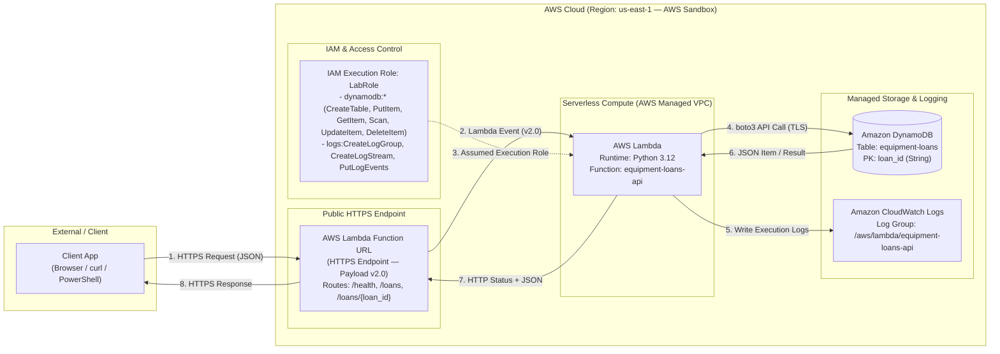

# Laporan Proyek Individu — Week 12: Design & AWS Setup

**Mata Kuliah:** AWS Cloud Computing  
**Judul Proyek:** Sistem Peminjaman Alat Laboratorium (*Equipment Loans API*)  
**Track Terpilih:** Track C — Serverless (`AWS Lambda Function URL` + `AWS Lambda` + `Amazon DynamoDB`)  
**Use Case:** Equipment Loans  
**Region AWS:** `us-east-1` (AWS Academy / Vocareum Sandbox)

---

## 1. Architecture Diagram

### Diagram Arsitektur Solusi



### Penjelasan Komponen, Alur Data, Jaringan, & IAM
- **Public Endpoint (AWS Lambda Function URL):** Menerima request HTTPS dari client dan meneruskannya ke AWS Lambda menggunakan payload format HTTP v2.0. Pada lingkungan sandbox `voclabs`, izin `apigateway:POST` dibatasi oleh policy lab sehingga Lambda Function URL digunakan sebagai alternatif endpoint HTTPS publik (pada lingkungan produksi dapat diganti dengan Amazon API Gateway HTTP API tanpa mengubah kode Lambda).
- **Compute (AWS Lambda — Python 3.12):** Fungsi `equipment-loans-api` memproses routing `/health` serta 4 operasi CRUD `/loans` menggunakan library `boto3`.
- **Storage (Amazon DynamoDB):** Tabel `equipment-loans` dengan mode `PAY_PER_REQUEST` (*On-demand*) dan Partition Key `loan_id` (`String`).
- **IAM & Security (`LabRole`):** Role pengguna sandbox `voclabs` tidak memiliki izin `dynamodb:CreateTable` maupun pembuatan IAM Role baru. Oleh karena itu, Lambda menggunakan **`LabRole`** yang memiliki izin `dynamodb:*` di `us-east-1`. Saat endpoint `/health` dipanggil pertama kali, Lambda (`LabRole`) otomatis membuat tabel `equipment-loans` jika belum tersedia.
- **Network Boundary:** Seluruh layanan berjalan di atas *AWS Managed Network* dengan komunikasi terenkripsi TLS, tanpa perlu konfigurasi VPC/Subnet/Security Group manual.

---

## 2. Design Brief

### 2.1 Use Case & Alasan Pemilihan Track C
Sistem ini memfasilitasi pencatatan peminjaman alat laboratorium/kampus (seperti oscilloscope, multimeter, atau perangkat jaringan) secara terpusat melalui HTTP API. **Track C (Serverless)** dipilih karena:
1. Tidak membutuhkan waktu provisioning RDS maupun konfigurasi VM/VPC seperti Track A/B, sehingga sangat sesuai dengan batas sesi **AWS Sandbox (3 jam)**.
2. Menggunakan skema *pay-per-use* (`Lambda` + `DynamoDB On-demand`) yang hemat kredit sandbox.
3. Mendukung otomasi *re-deploy* cepat menggunakan script setiap kali sesi sandbox di-reset.

### 2.2 Data Entity: `EquipmentLoan`
Disimpan pada tabel DynamoDB `equipment-loans`:

| Atribut | Tipe | Keterangan |
|---|---|---|
| `loan_id` | `String` | **Partition Key** (UUID v4, otomatis dibuat saat `POST`) |
| `borrower_name` | `String` | Nama lengkap peminjam |
| `borrower_id` | `String` | NIM / ID peminjam |
| `equipment_name` | `String` | Nama alat yang dipinjam |
| `quantity` | `Number` | Jumlah unit (minimal `1`) |
| `status` | `String` | `BORROWED` (default) atau `RETURNED` |
| `borrowed_at` | `String` | Timestamp waktu pinjam (ISO-8601 UTC) |
| `due_date` | `String` | Target tanggal pengembalian (`YYYY-MM-DD`) |
| `returned_at` | `String` | Timestamp pengembalian (opsional, otomatis diisi saat `RETURNED`) |

### 2.3 Spesifikasi 4 CRUD Endpoints (+ Health Check)

| Method | Path | Operasi | Fungsi |
|---|---|---|---|
| `GET` | `/health` | Health Check | Cek status Lambda & memastikan tabel DynamoDB `ACTIVE` |
| `POST` | `/loans` | **Create** | Mencatat transaksi peminjaman baru (`201 Created`) |
| `GET` | `/loans` | **Read (List)** | Mengambil seluruh daftar peminjaman (`200 OK`) |
| `GET` | `/loans/{loan_id}` | **Read (Detail)** | Mengambil detail peminjaman berdasarkan `loan_id` (`200 OK`) |
| `PUT` | `/loans/{loan_id}` | **Update** | Memperbarui `status` (`RETURNED`), `due_date`, atau `quantity` (`200 OK`) |
| `DELETE` | `/loans/{loan_id}` | **Delete** | Menghapus data peminjaman berdasarkan `loan_id` (`200 OK`) |

**Contoh Request `POST /loans`:**
```json
{
  "borrower_name": "Budi Santoso",
  "borrower_id": "220123456",
  "equipment_name": "Oscilloscope Rigol DS1054Z",
  "quantity": 1,
  "due_date": "2026-12-03"
}
```

---

## 3. Git Repository & Deployment Plan

Repository proyek tersimpan secara lokal di `D:\Game\projectaws` dengan struktur:
- `README.md` — Ringkasan proyek, daftar endpoint, dan deployment plan.
- `src/lambda_function.py` — Handler AWS Lambda (`Python 3.12`) untuk seluruh endpoint CRUD & auto-create tabel DynamoDB.
- `src/local_test.py` — Unit test offline (`python -m unittest discover -s src -p "*test*.py" -v`) dengan hasil **3/3 tests OK**.
- `scripts/setup-aws.ps1` & `scripts/setup-aws.sh` — Script otomasi deploy ulang infrastruktur saat sesi sandbox 3 jam dimulai.
- `scripts/save-evidence.ps1` — Script pengujian live & backup data DynamoDB ke folder `evidence/`.
- `docs/` — Dokumentasi arsitektur, design brief, panduan setup, dan laporan ini.

### Progressive Commits
Repository dibangun secara bertahap dengan commit history yang terstruktur:
1. `bd71d59` — `chore: initialize repository with README and gitignore`
2. `2b32362` — `docs: add design brief and serverless architecture diagram`
3. `c2b5774` — `feat: implement EquipmentLoan CRUD Lambda handler and requirements`
4. `17d9602` — `test: add offline unit tests and make boto3 import optional locally`
5. `c056dba` — `docs: add AWS Learner Lab setup guide and evidence checklist`
6. `d699bc6` — `feat: add sandbox auto-setup and evidence backup scripts`
7. `8902b09` — `fix: auto-create DynamoDB via LabRole and fallback to Lambda Function URL`
8. `fc7ad39` — `docs: align architecture diagram, design brief, and setup guide with Lambda Function URL`

---

## 4. AWS Evidence (Connectivity & Test Outputs)

Deployment telah diverifikasi langsung pada akun AWS Sandbox (`Account ID: 562544635771`, Region: `us-east-1`):

- **Live Endpoint (Lambda Function URL):**  
  `https://dhhveo7c4ngrtmvcchon57svmm0twlpg.lambda-url.us-east-1.on.aws`
- **Hasil Uji Konektivitas (`GET /health`):**
  ```json
  {
    "status": "ok",
    "table": "equipment-loans",
    "table_status": "ACTIVE"
  }
  ```
- **Hasil Uji `POST /loans` & `GET /loans`:**  
  Berhasil menyimpan dan membaca kembali **2 item** data peminjaman pada tabel DynamoDB `equipment-loans` (tersimpan di `evidence/aws-evidence-20261126-120628.txt` dan `evidence/dynamodb-backup-20261126-120628.json`).
- **Lampiran Screenshot:**
  1. Tabel DynamoDB `equipment-loans` berstatus `Active` & halaman **Explore items** (`2` item tersimpan).
  2. Halaman Overview Lambda `equipment-loans-api` (menampilkan **Function URL** & **Execution role `LabRole`**).
  3. Detail IAM Role `LabRole` & hasil Lambda **Test Event** `/health` (`Execution result: succeeded`, `statusCode: 200`).
  4. Hasil akses live endpoint `/loans` melalui browser dan output terminal `save-evidence.ps1`.
