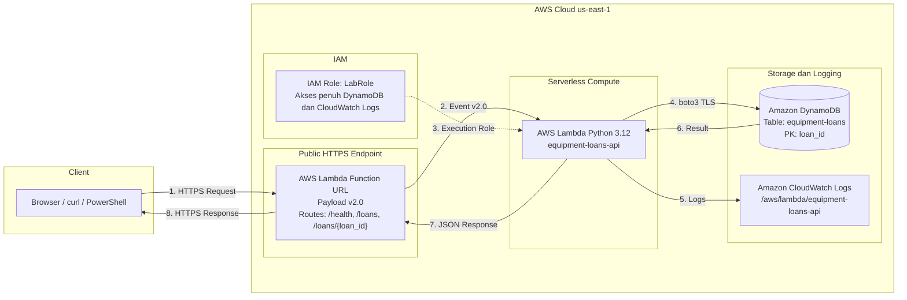

# Laporan Proyek Week 12: Design dan AWS Setup

Mata Kuliah: AWS Cloud Computing
Proyek: Sistem Peminjaman Alat Lab Equipment Loans API
Track: Track C Serverless dengan Lambda Function URL, AWS Lambda, dan Amazon DynamoDB
Region: `us-east-1`

## 1. Architecture Diagram

1. Request HTTPS dari client masuk ke Lambda Function URL. Function URL dipakai sebagai endpoint publik karena policy sandbox `voclabs` membatasi `apigateway:POST`.
2. Lambda `equipment-loans-api` memproses routing `/health` dan 4 operasi CRUD `/loans`.
3. Lambda memakai execution role `LabRole` yang memiliki akses `dynamodb:*` di `us-east-1`. Saat `/health` dipanggil pertama kali, Lambda otomatis membuat tabel DynamoDB `equipment-loans`.
4. Komunikasi antar layanan berjalan di jaringan terkelola AWS dengan enkripsi TLS, dan log eksekusi tercatat di CloudWatch Logs.

## 2. Design Brief

### Use Case dan Track
Sistem ini mencatat peminjaman alat laboratorium melalui endpoint HTTP. Track C Serverless dipilih karena proses setup cepat untuk sesi sandbox 3 jam, biaya rendah dengan skema bayar sesuai pemakaian, dan tidak memerlukan konfigurasi VPC atau RDS secara manual.

### Data Entity: `EquipmentLoan`
Disimpan pada tabel DynamoDB `equipment-loans`:

| Atribut | Tipe | Keterangan |
|---|---|---|
| `loan_id` | `String` | Partition Key UUID v4 |
| `borrower_name` | `String` | Nama peminjam |
| `borrower_id` | `String` | NIM atau ID peminjam |
| `equipment_name` | `String` | Nama alat |
| `quantity` | `Number` | Jumlah unit |
| `status` | `String` | `BORROWED` atau `RETURNED` |
| `borrowed_at` | `String` | Waktu pinjam ISO 8601 UTC |
| `due_date` | `String` | Batas tanggal kembali |
| `returned_at` | `String` | Waktu kembali saat status `RETURNED` |

### 4 Endpoint CRUD dan Health Check
| Method | Path | Operasi | Fungsi |
|---|---|---|---|
| `GET` | `/health` | Health Check | Cek status Lambda dan tabel DynamoDB |
| `POST` | `/loans` | Create | Catat peminjaman alat baru |
| `GET` | `/loans` | Read | Ambil daftar atau detail peminjaman |
| `PUT` | `/loans/{loan_id}` | Update | Ubah status pengembalian atau `due_date` |
| `DELETE` | `/loans/{loan_id}` | Delete | Hapus data peminjaman |

## 3. Git Repository dan Deployment Plan
Repository tersedia di `https://github.com/juancrcr/Project-aws` dengan progressive commits, dokumentasi lengkap, kode handler `src/lambda_function.py`, unit test offline `src/local_test.py` dengan hasil 3 dari 3 test lulus, serta script otomasi `scripts/setup-aws.ps1` dan `scripts/save-evidence.ps1` untuk deploy ulang saat sandbox reset setiap 3 jam.

## 4. AWS Evidence
Pengujian live dilakukan pada akun AWS Sandbox `562544635771` di region `us-east-1` dengan endpoint `https://dhhveo7c4ngrtmvcchon57svmm0twlpg.lambda-url.us-east-1.on.aws`:

1. Gambar 0: Tabel DynamoDB `equipment-loans` berstatus `Active` dengan Partition Key `loan_id` dan mode `On-demand`.
2. Gambar 1: Halaman Explore items pada tabel `equipment-loans` menampilkan 2 item data peminjaman yang berhasil tersimpan.
3. Gambar 2: Halaman overview Lambda `equipment-loans-api` menampilkan Function ARN, Function URL, dan Execution role `LabRole`.
4. Gambar 3: Tab Configuration Permissions pada Lambda menunjukkan policy `LabRole` yang aktif.
5. Gambar 4: Halaman IAM Role `LabRole` menampilkan 4 policy terpasang untuk akses DynamoDB dan CloudWatch Logs.
6. Gambar 5: Tab Test di konsol Lambda menunjukkan eksekusi `/health` berhasil dengan `statusCode` 200 dan `table_status` `ACTIVE`.
7. Gambar 6: Akses langsung endpoint `/loans` melalui browser menampilkan data JSON dengan 2 item peminjaman.
8. Gambar 7: File `evidence/aws-evidence-20261126-120628.txt` merekam hasil uji `GET /health`, `POST /loans`, dan `GET /loans` secara lengkap.
