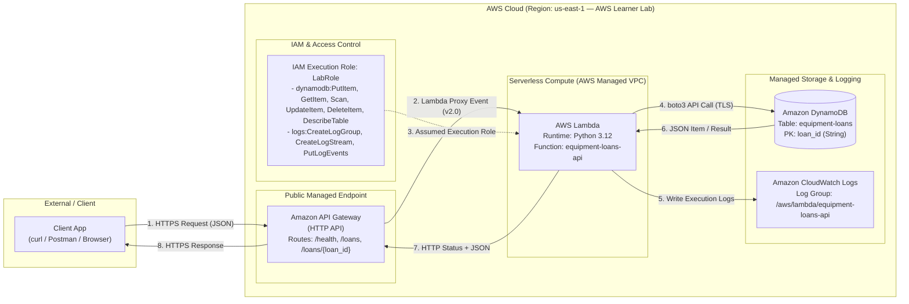

# Architecture Diagram & Security Design

Dokumen ini menjelaskan arsitektur solusi **Equipment Loans API** menggunakan **Track C (Serverless)** pada AWS Learner Lab.

## 1. Diagram Arsitektur (Request/Data Flow, Network, & IAM)

## 2. Penjelasan Komponen & Alur Data

1. **Client -> Amazon API Gateway (HTTP API):**
   Client mengirim request HTTPS ke Invoke URL API Gateway. API Gateway menangani terminasi TLS dan validasi rute (`/health`, `/loans`, `/loans/{loan_id}`).
2. **API Gateway -> AWS Lambda:**
   API Gateway meneruskan request menggunakan **Lambda Proxy Integration (Payload Format v2.0)** ke fungsi `equipment-loans-api`.
3. **IAM & Security (`LabRole`):**
   Di lingkungan **AWS Learner Lab**, pembuatan IAM Role baru dibatasi. Oleh karena itu, Lambda menggunakan `LabRole` sebagai execution role. `LabRole` memberikan prinsip akses yang dibutuhkan Lambda untuk membaca/menulis ke DynamoDB serta mengirim log ke CloudWatch tanpa menyimpan credential statis (access key) di dalam kode.
4. **Network Boundary:**
   Seluruh komponen (`API Gateway`, `Lambda`, `DynamoDB`) berjalan di atas infrastruktur **AWS Managed Network** sehingga komunikasi antar-layanan berlangsung melalui jaringan internal AWS yang terenkripsi TLS, tanpa perlu mengelola Subnet, NAT Gateway, atau Security Group secara manual.
5. **Observability (`CloudWatch Logs`):**
   Setiap eksekusi Lambda dan error otomatis tercatat di CloudWatch Logs (`/aws/lambda/equipment-loans-api`) untuk memudahkan debugging dan sebagai bukti (*AWS evidence*).
