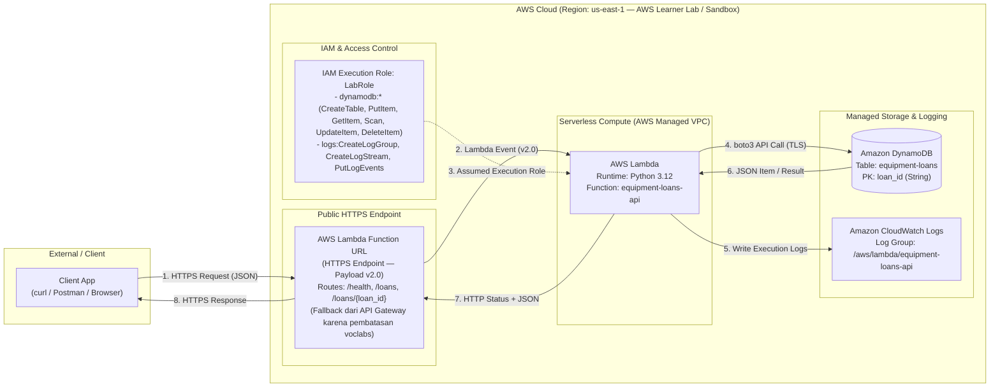

# Architecture Diagram & Security Design

Dokumen ini menjelaskan arsitektur solusi **Equipment Loans API** menggunakan **Track C (Serverless)** pada AWS Learner Lab.

## 1. Diagram Arsitektur (Request/Data Flow, Network, & IAM)

## 2. Penjelasan Komponen & Alur Data

1. **Client -> AWS Lambda Function URL:**
   Client mengirim request HTTPS ke Lambda Function URL (`https://<id>.lambda-url.us-east-1.on.aws`). Function URL menangani terminasi TLS dan meneruskan payload format HTTP v2.0 ke fungsi Lambda. *(Catatan: Di sandbox `voclabs`, `apigateway:POST` dibatasi oleh policy lab, sehingga Lambda Function URL digunakan sebagai HTTPS endpoint publik; pada lingkungan produksi, layer ini dapat diganti dengan Amazon API Gateway HTTP API tanpa mengubah kode Lambda).*
2. **AWS Lambda (`equipment-loans-api`):**
   Fungsi Lambda Python 3.12 mem-parsing `rawPath` dan HTTP `method` untuk merutekan request ke `/health` maupun 4 operasi CRUD `/loans`.
3. **IAM & Security (`LabRole`):**
   Di lingkungan **AWS Learner Lab / Sandbox**, role user `voclabs` dibatasi (tidak memiliki `dynamodb:CreateTable` maupun pembuatan IAM Role baru). Oleh karena itu, Lambda dijalankan menggunakan **`LabRole`** yang memiliki izin `dynamodb:*` di `us-east-1`. Saat `/health` dipanggil pertama kali, Lambda (`LabRole`) otomatis membuat tabel `equipment-loans` jika belum tersedia.
4. **Network Boundary:**
   Seluruh komponen (`Lambda Function URL`, `Lambda`, `DynamoDB`) berjalan di atas infrastruktur **AWS Managed Network** sehingga komunikasi antar-layanan berlangsung melalui jaringan internal AWS yang terenkripsi TLS, tanpa perlu mengelola Subnet, NAT Gateway, atau Security Group secara manual.
5. **Observability (`CloudWatch Logs`):**
   Setiap eksekusi Lambda dan error otomatis tercatat di CloudWatch Logs (`/aws/lambda/equipment-loans-api`) untuk memudahkan debugging dan sebagai bukti (*AWS evidence*).
