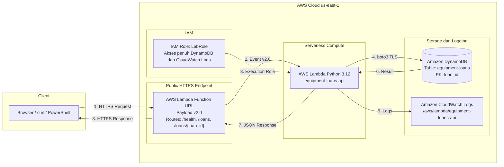

# Architecture Diagram dan Keamanan

Dokumen ini menjelaskan rancangan arsitektur Equipment Loans API pada Track C Serverless di AWS Sandbox.

## 1. Diagram Arsitektur

## 2. Alur Data dan Keamanan
1. Client mengirim request HTTPS ke Lambda Function URL. Function URL dipilih sebagai endpoint publik karena akun sandbox `voclabs` membatasi pembuatan API Gateway.
2. Lambda `equipment-loans-api` menerima event format v2.0 lalu mengarahkan request ke `/health` atau operasi CRUD `/loans`.
3. Lambda berjalan memakai `LabRole` yang sudah memiliki izin `dynamodb:*` di `us-east-1`. Saat `/health` pertama kali dipanggil, Lambda otomatis membuat tabel `equipment-loans` jika belum tersedia.
4. Seluruh komponen berada di jaringan terkelola AWS sehingga komunikasi antar layanan sudah terenkripsi TLS tanpa perlu membuat VPC atau Security Group secara manual.
5. Setiap log eksekusi dikirim ke CloudWatch Logs di grup `/aws/lambda/equipment-loans-api`.
